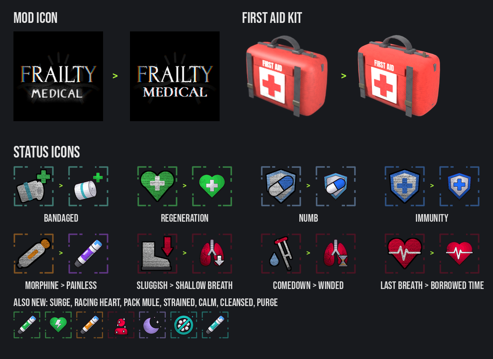

## 0.10.2 (Beta)
- Fixed the real cause of the 0.10.1 problem: the items ran their use on BepInEx' own object, which the game can remove when it loads a scene. Now they run on their own object, so the medical items work without StaticNetcodeLib.
- StaticNetcodeLib is no longer needed (FrailtyMedical never used it).
- Fixed: Morphine's revive. The revived player's HUD stayed hidden, and the others couldn't see the revived player.
- Fixed: a pen used on a teammate didn't give them anything after you left a lobby and hosted or joined another one (the same for revives and the others hearing your items): it works in every lobby now, not just the first one.
- Fixed: typing part of an item's name in the terminal could buy the wrong thing ("first aid"). The first word of an item's name, or its name written together ("firstaidkit"), now finds the item. The first word of a medical item's name is always that item in the terminal: `first` is the First Aid Kit (Sigurd's first log is now `log first`).
- Fixed: without EladsHUD+, the buff icons drifted a little further off with every icon before them. They now line up along the same tilted line as FrailtyPlus' icons.
- Fixed: on some setups (where BepInEx' own object is removed when the game loads a scene) the mod lost track of the other mods: EladsHUD+'s status row and bar colors, TZPPlus, AdvancedCompany's terminal and TerminalFormatter weren't found.
- Buff icons without EladsHUD+: the frame moves like FrailtyPlus' icons (its dashes change a few times a second), and debuff pictures slowly pulse red, like FrailtyPlus' injuries.

## 0.10.1 (Beta)
- Fixed Medical items did nothing when StaticNetcodeLib was not installed.
- StaticNetcodeLib (by Xilophor) is now a required dependency.

## 0.10.0 (Beta)

### New
- **3 new items**:
  - **Antifungal** ($250): cures a Cadaver infection at any stage and resets your air filter, then **Cleansed** for 2 min keeps spores off you and your air filter from wearing down.
  - **Steroids** ($250): **Pack Mule** for 2:30, no weight slowdown and 2 big items (the second one stays in your hands); then **Strained**. A teammate's body never goes into your inventory.
  - **Sedatives** ($200 pills, also found as scrap): no paranoia, **Calm** for 3 min.
- **MEDICAL store section**: every medical item (and the TZP-Inhalant, UsualScrap's Bandages / Medical Kit) gets its own section in the store, not CONSUMABLES. Works with TerminalFormatter and AdvancedCompany's terminal. With Drinkable, MEDICAL comes first, then DRINKS.
- **Pens on a teammate**: look at a teammate and hold [LMB] to inject them with any pen (the First Aid Kit's ETG-c shot, aimed at them). Moving apart or letting go stops it and nothing is lost. Morphine's revive works the same way now.
- **Injections into yourself can't be stopped** once they start (Morphine, Epinephrine, Antifungal, Steroids). Only dying stops one: then nothing happens and the pen isn't used up.
- **Borrowed Time**: a red tint and dark edges on your screen (stronger in the last 15 s). A player whose Borrowed Time runs out now leaves a body, but nothing can revive it until the day ends (Morphine, BunkbedRevive, UsualScrap's Defibrillator).
- **Bar colors**: buffs tint EladsHUD+'s health and stamina bars and the game's stamina meter (Bandaged: teal).
- **Bandaged** stacks: another bandage while one still heals adds its healing and time on top.
- **Sound update**: real recorded sounds for picking up and dropping the First Aid Kit, the pens and the pill bottles, for injecting (click, needle, medicine), and for the kit's zip and searching for the ETG-c. Every sound is levelled to the same loudness.
- The hover text shows `[Hands full]` instead of `Grab : [E]` when you can't pick something up.
- Works with Drinkable 1.2.0+ (its new name inside); older Drinkable versions aren't seen anymore.
- Needs FrailtyPlus 1.2.0.

### Balance changes
| What | Before | Now |
|---|---|---|
| Epinephrine | +50 health | heals 90 while it goes in (Surge), then **Racing Heart**: 50 extra health for 2 min |
| Epinephrine: Concussed after the shot | 10 s | 5 s |
| Painkillers: Regeneration | 90 over 30 s | 50 over 60 s, not while you bleed |
| Immunity (Antibiotics) | injuries only | also blocks Cadaver spores; no longer touches FrailtyPlus' Infected / Blooming / Paranoid icons |
| Healing while bleeding | yes | no (FrailtyPlus 1.2.0 rule): only the Bandage, the First Aid Kit and Epinephrine still heal you |

### Icon changes

- New mod icon: the Frailty font and glitch look.
- First Aid Kit: a cloth bag instead of plastic.
- New Morphine / Epinephrine / pill bottle item icons, new Antifungal and Steroids models and icons.
- New status icons for every buff.

### Renames and tooltip changes
- Morphine's buff is now **Painless** (purple), Sluggish is now **Shallow Breath**, Comedown is now **Winded**, Last Breath is now **Borrowed Time**.
- **Painless**: "You barely feel a thing: you take much less damage."
- **Shallow Breath**: "Morphine slows your breathing: sprinting tires you out much faster."
- **Winded**: "The morphine is wearing off and you're out of breath: your stamina refills slower and you limp."
- **Borrowed Time**: "You're back, barely: you take much less damage but can't regenerate. Get healed to 20 HP before the timer runs out, or you're gone until the day ends."
- **Immunity**: "The antibiotics keep you safe: new injuries and Cadaver spores can't get you. Bleeding still can."

### Fixes
- A used-up item's control tip (top of the screen) now goes away with it.
- With OpenBodyCams, the body cam showed the First Aid Kit still in your hand while you used it.

## 0.9.1
- Fixed healing over time giving 1 HP less than it should (the Bandage healed 19 instead of 20, Painkillers 89 instead of 90).
- README: every buff / debuff icon with what it does.

## 0.9.0 (Beta)
- First public release, as a **beta**: not configurable yet (everyone plays with the same tested values).
- First Aid Kit use: set down at your hip, the ETG-c shot into your wrist, then the Dressing wrapped on (the wrap repeats until the use time is up). New ETG-c and Dressing models.
- First-person arm animations for every item, made on the game's own arm rig.
- Earlier test build (1.0.0): Bandage, First Aid Kit, Morphine, Epinephrine, Painkillers (the vanilla Pill bottle) and Antibiotics, all in the store; the pills are also found as scrap.
- Bandage and First Aid Kit: hold [LMB] with a progress circle. Injectors and pills: one click, like drinking a soda.
- Morphine revives a dead teammate with Last Breath (heal them to 20 health within 1:30 or they're gone for the day), or gives you 60% damage reduction with side effects.
- Bandage: Bandaged buff (heals 20 over 5 s) after putting it on.
- Our own models (auto-injectors with the medicine visible in a window, going down while you inject; a medic bag carried by its handle), icons and sounds (cloth for the bandage and bag, the needle going in). Your arm moves with the item while using it.
