# FrailtyMedical (Beta)

> **Beta release.** The numbers are not configurable yet, so every lobby plays with the same values. Please report anything odd.

An add-on for [FrailtyPlus](https://thunderstore.io/c/lethal-company/p/SleepyMiles/FrailtyPlus/): real medical supplies to treat its injuries.

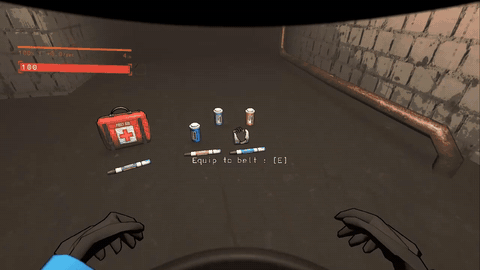 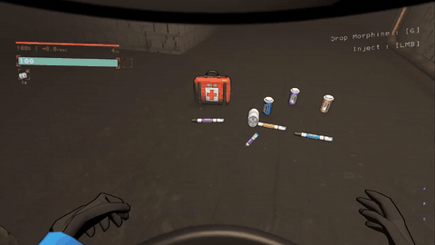

*Left: putting on a Bandage. Right: a Morphine pen.*

## Items

| Item | Store | What it does |
|---|---|---|
|  **Bandage** | $150 | **Hold [LMB]** for 3.5 s (let go = stop), 3 uses. Stops **Bleeding** and clears **Laceration**; **Fatal Bleeding** is slowed down to Bleeding (use another one to stop it). Then **Bandaged**: heals 20 over 5 s, even while you bleed; another one while it's still healing adds its 20 and 5 s on top. Can be used any time. |
| 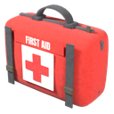 **First Aid Kit** | $200 | Carried by its handle. **Hold [LMB]** for 10 s, 2 uses: you set it down at your hip, inject the ETG-c into your wrist, then wrap a Dressing on. Treats every injury and every kind of bleeding, and heals you to full health. |
| 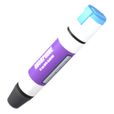 **Morphine** | $250 | An auto-injector, one click (3.2 s). **On a dead teammate's body** (look at it and hold [LMB]): they come back with **Borrowed Time** for 1:30: 10 health, 90% less damage, no natural healing, and a red tint on their screen. Healed to 20 health in time (First Aid Kit, Epinephrine, Painkillers, any healing) and they live; otherwise they die again and are gone **until the end of the day**: their body stays and can be carried, but nothing can revive it (not Morphine, UsualScrap's Defibrillator or BunkbedRevive). Scanning it shows "*name* - can't be revived today". **On yourself** (needle end toward you): injecting drains your stamina, then 60% less damage for 3 min (**Painless**) with **Shallow Breath** (sprinting drains much faster, not as bad as a broken leg), then 1 min of **Winded** (slower stamina refill and a limp). |
| 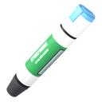 **Epinephrine** | $250 | An auto-injector, one click (3.2 s). **Surge**: heals 90 while it goes in, even while you bleed. Then **Racing Heart** for 2 min: 50 extra health on top of your normal health (damage uses it up first; when the time is up, what's left drains away in 2 s; another shot resets it). **Concussed** for 5 s after the shot. |
| 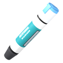 **Antifungal** | $250 | An auto-injector, one click (3.2 s). Cures a **Cadaver infection** at any stage with the game's own cure (the flowers, spores, screen effect, ringing in your ears and slowdown all go) and resets your suit's air filter (Filter quality back to 100%). While **Blooming** it's the First Aid Kit's wrist shot instead, and it costs 30 health when the needle goes in (never below 1). **Purge** while it goes in, then **Cleansed** for 2 min: spores can't infect you and your air filter doesn't wear down. |
|  **Steroids** | $250 | An auto-injector, one click (3.2 s). **Pack Mule** for 2:30: weight doesn't slow you or tire you, and you can carry **2 big items** (not a teammate's body: that one you still carry in your hands): holding one, you can still switch slots and pick things up (like MoreShipUpgrades' Deeper Pockets; its extra slots add on top); the second one stays in your hands until you drop one. 10 s before it ends you get a warning and the icon blinks; when it ends, a second big item in your inventory drops at your feet (if it's your only one, it goes into your hands instead). Then **Strained** for 30 s: weight slows you and drains stamina 25% more. |
| 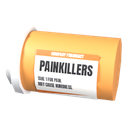 **Painkillers** | $200, or found as scrap (the vanilla Pill bottle) | One click (1.6 s), 2 uses. **Numb** (30% less damage for 30 s) and **Regeneration** (heals 50 over 60 s; it doesn't heal while you bleed). |
| 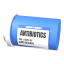 **Antibiotics** | $250, or found as scrap (blue pill bottle) | One click (1.6 s), 2 uses. **Immunity** for 3 min: clears FrailtyPlus injuries and blocks new ones and Cadaver spores, also clears other mods' debuffs (vanilla drunkenness, Drinkable's Dehydration / Hyponatremia). Not bleeding of any kind, not a Cadaver infection you already have, not Drinkable's Sugar Crash, not TZPPlus' Lethal Dose. |
| 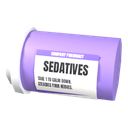 **Sedatives** | $200, or found as scrap (lavender pill bottle) | One click (1.6 s), 2 uses. Paranoia drops to 0, then **Calm** for 3 min: paranoia can't build up, fear doesn't cloud your vision (the chase music and heartbeat still warn you), and an infection can't make you cough up spores. With TZPPlus: Withdrawal wears off twice as fast. |

- **Pens on a teammate**: look at a teammate within reach and **hold [LMB]** to inject them with Morphine, Epinephrine, Antifungal or Steroids (4 s, the First Aid Kit's ETG-c shot aimed at them). Letting go or moving apart stops it and nothing is lost: the pen isn't used up and they get nothing. When it finishes they get the full effect (Epinephrine's 90 health all at once) and a "*name* gave you ..." tip. Morphine on a dead teammate's body is the revive. Not looking at anyone = the pen goes into you.
- **Injections into yourself can't be stopped**: once it starts going in, switching slots, dropping or pocketing are blocked and getting hit doesn't stop it. Only dying does: then nothing of it happens and the pen isn't used up (it drops with your other items).
- **No healing while bleeding** (FrailtyPlus' rule, on by default): only the Bandage, the First Aid Kit and Epinephrine heal you while you have Bleeding, Laceration or Fatal Bleeding.
- Bought items are tools: worth nothing, gone after their last use, kept on the ship when everyone dies (also with AdvancedCompany's Save Loot). Pills found as scrap keep their value when empty.
- Uses left are saved with the ship and synced to everyone.
- `info bandage`, `info morphine`, ... in the terminal tells what each does.

## Buff icons

Shown in EladsHUD+'s status row when it's installed; otherwise in the bottom-left corner, the same size and look as FrailtyPlus' own icons (time left above each), on the same line after FrailtyPlus, TZPPlus and Drinkable's icons.

-  `Bandaged` (buff): Freshly bandaged: you heal a little.
-  `Regeneration` (buff): The pills help you recover: you slowly heal over time.
-  `Numb` (buff): The pills dull the pain: you take less damage.
- 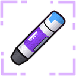 `Painless` (buff): You barely feel a thing: you take much less damage.
-  `Immunity` (buff): The antibiotics keep you safe: new injuries and Cadaver spores can't get you. Bleeding still can.
- 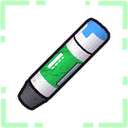 `Surge` (buff): The shot is going in: you heal quickly while you inject.
-  `Racing Heart` (buff): Your heart is pounding: you have extra health on top of your normal health until it wears off.
- 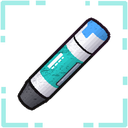 `Purge` (buff): The antifungal is going in: it's killing the spores inside you.
-  `Cleansed` (buff): The antifungal cleared you out: Cadaver spores can't take hold and your air filter doesn't wear down for a while.
- 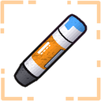 `Pack Mule` (buff): You could carry a car: weight doesn't slow you down or tire you, and you can carry two big items - one in your hands, one on your back. When it wears off, the one on your back drops.
-  `Calm` (buff): You feel calm: paranoia can't build up, fear doesn't cloud your vision, and if you're infected you don't cough up spores.
- 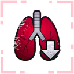 `Shallow Breath` (debuff): Morphine slows your breathing: sprinting tires you out much faster.
- 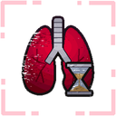 `Winded` (debuff): The morphine is wearing off and you're out of breath: your stamina refills slower and you limp.
-  `Strained` (debuff): Your back is paying for it: carried weight slows you down and tires you out more for a while.
-  `Borrowed Time` (debuff): You're back, barely: you take much less damage but can't regenerate. Get healed to 20 HP before the timer runs out, or you're gone until the day ends.

The bars change color too (EladsHUD+'s health and stamina bars, and the game's stamina meter): health purple while Painless, green while Surge, teal while Bandaged; stamina red with Shallow Breath, Winded or Strained, amber with Pack Mule. With EladsHUD+, Racing Heart's extra health is a green part of the health bar.

## Store

The medical items, the TZP-Inhalant and UsualScrap's Bandages / Medical Kit get a **MEDICAL** section on the store page (vanilla terminal, TerminalFormatter and the AdvancedCompany mobile terminal). With Drinkable, its DRINKS section comes after it.

## Config

Not configurable during the beta, to keep it bug-free: every player gets the same tested values (prices, uses, use times, durations, Borrowed Time health and time, ...). A config file can't change them. Full config is planned (see Future plans).

## Needs

- [FrailtyPlus](https://thunderstore.io/c/lethal-company/p/SleepyMiles/FrailtyPlus/) 1.2.0 or newer (required)
- CSync

## Compatibility

- **[FrailtyPlus](https://thunderstore.io/c/lethal-company/p/SleepyMiles/FrailtyPlus/)** (required): the items treat its injuries and bleeding.
- **[TZPPlus](https://thunderstore.io/c/lethal-company/p/SleepyMiles/TZPPlus/)**: Antibiotics clear Withdrawal (not Lethal Dose), Sedatives' Calm makes Withdrawal wear off faster; the icons share one row.
- **[Drinkable](https://thunderstore.io/c/lethal-company/p/SleepyMiles/Drinkable/)** (1.2.0+): its DRINKS store section comes after MEDICAL, Antibiotics clear its Dehydration / Hyponatremia.
- **[EladsHUD+](https://thunderstore.io/c/lethal-company/p/SleepyMiles/EladsHUDPlus/)**: every buff shows in its status row with time left and tooltips, the bars change color, and Racing Heart's extra health shows on the health bar.
- **OpenBodyCams**: the body cam shows the First Aid Kit set down at your hip (and the injectors moving) while you use them, not stuck in your hand.
- **BunkbedRevive**, **UsualScrap**'s Defibrillator: can't revive a player who is gone for the day.
- **MoreShipUpgrades**: Deeper Pockets' extra big items add to Pack Mule's.
- **TerminalFormatter**, **AdvancedCompany** (SleepyMiles V81 version, Save Loot), **RuntimeIcons**.
- **Everyone in the lobby needs this mod.**

## Play them together

These mods are made by **SleepyMiles** to work as one set. They share one row of buff / debuff icons (or EladsHUD+'s status row) and the **DRINKS** / **MEDICAL** store sections, and they know about each other's effects. Each one also works on its own (FrailtyMedical needs FrailtyPlus).

| Mod | What it adds |
|---|---|
| [TZPPlus](https://thunderstore.io/c/lethal-company/p/SleepyMiles/TZPPlus/) | The TZP heals you, shows its gas, builds up damage reduction (fall damage too). Too much gives a Lethal Dose. |
| [FrailtyPlus](https://thunderstore.io/c/lethal-company/p/SleepyMiles/FrailtyPlus/) | Injuries: broken / fractured legs and arms, bleeding, concussions, Paralyze. A rebuilt Frailty. |
| **FrailtyMedical** (this mod) | *Beta.* Bandage, First Aid Kit, Morphine (revive a teammate), Epinephrine, Antifungal, Steroids, Painkillers, Antibiotics and Sedatives to treat them. |
| [Drinkable](https://thunderstore.io/c/lethal-company/p/SleepyMiles/Drinkable/) | Drink the Red soda, 19 new drinks with their own buffs, the Soda Machine and the Drink Machine. |
| [EladsHUD+](https://thunderstore.io/c/lethal-company/p/SleepyMiles/EladsHUDPlus/) | Elad's HUD for V81, with a status row that shows every buff, debuff and injury from all of these with the `time left`. |

## Future plans

- **Sound update, part 2**: the Bandage and the rest of the First Aid Kit sequence (dressing, closing the kit).
- **Teammate view:** the use animations seen on your body by other players, not just in first person.
- **Full config** again, once the beta is done.

## Original Frailty

FrailtyMedical is an add-on for FrailtyPlus, which is a fork of [Frailty](https://thunderstore.io/c/lethal-company/p/IntegrityChaos/Frailty/) by **IntegrityChaos** (formerly "Player Conditions" from [Diversity](https://thunderstore.io/c/lethal-company/p/IntegrityChaos/Diversity/)). All the credit for the original idea, icons and effects goes to them. If you like it, support the original creator:

- [Discord](https://discord.gg/4APzjc8fNW): IntegrityChaos' server.
- [Patreon](https://www.patreon.com/IntegrityChaos): support their work.

Please report bugs in FrailtyMedical to us (SleepyMiles), not to IntegrityChaos.

## Credits

- Made by **SleepyMiles**: models, icons, arm animations and code.
- IntegrityChaos for the original idea of [Frailty](https://thunderstore.io/c/lethal-company/p/IntegrityChaos/Frailty/)
