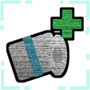
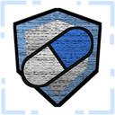
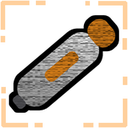
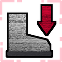
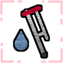

# FrailtyMedical (Beta)

> **Beta release.** The numbers are not configurable yet, so every lobby plays with the same values. Please report anything odd.

An add-on for [FrailtyPlus](https://thunderstore.io/c/lethal-company/p/SleepyMiles/FrailtyPlus/): real medical supplies to treat its injuries.

## Items

| Item | Store | What it does |
|---|---|---|
| **Bandage** | $150 | **Hold [LMB]** for 3.5 s (let go = stop), 3 uses. Stops **Bleeding** and clears **Laceration**; **Fatal Bleeding** is slowed down to Bleeding (use another one to stop it). Then **Bandaged**: heals 20 over 5 s. Can be used any time. |
| **First Aid Kit** | $200 | Carried by its handle. **Hold [LMB]** for 10 s, 2 uses: you set it down at your hip, inject the ETG-c into your wrist, then wrap a Dressing on. Treats every injury and every kind of bleeding, and heals you to full health. |
| **Morphine** | $250 | An auto-injector, one click (3.2 s). **On a dead teammate's body** (look at it): they come back with **Last Breath** for 1:30: 10 health, 90% less damage, no natural healing. Healed to 20 health in time (First Aid Kit, Epinephrine, Painkillers, any healing) and they live; otherwise they die for good **until the end of the day** (no body, so no defibrillator (UsualScrap)or bunk bed (BunkbedRevive) can bring them back). **On yourself** (needle end toward you): injecting drains your stamina, then 60% less damage for 3 min (**Morphine**) with **Sluggish** (sprinting drains much faster, not as bad as a broken leg), then 1 min of **Comedown** (slower stamina refill and a limp). |
| **Epinephrine** | $250 | An auto-injector, one click (3.2 s). +50 health, then **Concussed** for 10 s. |
| **Painkillers** | $200, or found as scrap (the vanilla Pill bottle) | One click (1.6 s), 2 uses. **Numb** (30% less damage for 30 s) and **Regeneration** (heals 90 over 30 s). |
| **Antibiotics** | $250, or found as scrap (blue pill bottle) | One click (1.6 s), 2 uses. **Immunity** for 3 min: clears FrailtyPlus injuries and blocks new ones, also clears other mods' debuffs (vanilla drunkenness, Drinkable's Dehydration / Hyponatremia). Not bleeding of any kind, not Drinkable's Sugar Crash, not TZPPlus' Lethal Dose. |

- Bought items are tools: worth nothing, gone after their last use, kept on the ship when everyone dies (also with AdvancedCompany's Save Loot). Pills found as scrap keep their value when empty.
- Uses left are saved with the ship and synced to everyone.
- `info bandage`, `info morphine`, ... in the terminal tells what each does.

## Buff icons

Shown in EladsHUD+'s status row when it's installed; otherwise in the bottom-left corner, the same size and look as FrailtyPlus' own icons (time left above each), on the same line after FrailtyPlus, TZPPlus and Drinkable's icons.

-  `Bandaged` (buff): Freshly bandaged: you heal a little.
-  `Regeneration` (buff): You slowly heal over time.
-  `Numb` (buff): The pills dull the pain: you take less damage.
-  `Morphine` (buff): You barely feel a thing: you take much less damage.
-  `Immunity` (buff): New injuries can't get you (bleeding still can).
-  `Sluggish` (debuff): Morphine side effect: sprinting tires you out much faster.
-  `Comedown` (debuff): The morphine is wearing off: your stamina refills slower and you limp.
-  `Last Breath` (debuff): You were brought back, barely. Get healed before time runs out, or you're gone for the day.

## Store

The medical items get a **CONSUMABLES** section on the store page (vanilla terminal and TerminalFormatter). With Drinkable installed, its section is used and the medical items join it. Drinkable's Pill bottle becomes FrailtyMedical's Painkillers.

## Config

Not configurable during the beta, to keep it bug-free: every player gets the same tested values (prices, uses, use times, durations, Last Breath health and time, ...). A config file can't change them. Full config is planned (see Future plans).

## Needs

- [FrailtyPlus](https://thunderstore.io/c/lethal-company/p/SleepyMiles/FrailtyPlus/) (required)
- CSync
## Compatibility

- **[FrailtyPlus](https://thunderstore.io/c/lethal-company/p/SleepyMiles/FrailtyPlus/)** (required): the items treat its injuries and bleeding.
- **[TZPPlus](https://thunderstore.io/c/lethal-company/p/SleepyMiles/TZPPlus/)**: Antibiotics clear Withdrawal (not Lethal Dose); the icons share one row.
- **[Drinkable](https://thunderstore.io/c/lethal-company/p/SleepyMiles/Drinkable/)**: its Pill bottle becomes FrailtyMedical's Painkillers, the items join its CONSUMABLES store section, Antibiotics clear its Dehydration / Hyponatremia.
- **[EladsHUD+](https://thunderstore.io/c/lethal-company/p/SleepyMiles/EladsHUDPlus/)**: every buff shows in its status row with time left and tooltips.
- **TerminalFormatter**, **AdvancedCompany** (SleepyMiles V81 version, Save Loot), **RuntimeIcons**.
- **Everyone in the lobby needs this mod.**

## Play them together

These mods are made by **SleepyMiles** to work as one set. They share one row of buff / debuff icons (or EladsHUD+'s status row) and one **CONSUMABLES** store section, and they know about each other's effects. Each one also works on its own (FrailtyMedical needs FrailtyPlus).

| Mod | What it adds |
|---|---|
| [TZPPlus](https://thunderstore.io/c/lethal-company/p/SleepyMiles/TZPPlus/) | The TZP heals you, shows its gas, builds up damage reduction (fall damage too). Too much gives a Lethal Dose. |
| [FrailtyPlus](https://thunderstore.io/c/lethal-company/p/SleepyMiles/FrailtyPlus/) | Injuries: broken / fractured legs and arms, bleeding, concussions, Paralyze. A rebuilt Frailty. |
| **FrailtyMedical** (this mod) | *Beta.* Bandage, First Aid Kit, Morphine (revive a teammate), Epinephrine, Painkillers and Antibiotics to treat them. |
| [Drinkable](https://thunderstore.io/c/lethal-company/p/SleepyMiles/Drinkable/) | Drink the Red soda and the pills, 9 new sodas with their own buffs, and the Soda Machine. |
| [EladsHUD+](https://thunderstore.io/c/lethal-company/p/SleepyMiles/EladsHUDPlus/) | Elad's HUD for V81, with a status row that shows every buff, debuff and injury from all of these with the `time left`. |

## Future plans

- **Sound update** for every item: injecting, bandaging, the pills, picking up and dropping each item, and the whole First Aid Kit sequence.
- **Teammate view:** the use animations seen on your body by other players, not just in first person.
- **Epinephrine:** a new buff.
- **Morphine:** a new debuff.
- **Bar colors:** the stamina and health bar color changes for both EladsHUD+ and the vanilla HUD.
- **Full config** again, once the beta is done.

## Original Frailty

FrailtyMedical is an add-on for FrailtyPlus, which is a fork of [Frailty](https://thunderstore.io/c/lethal-company/p/IntegrityChaos/Frailty/) by **IntegrityChaos** (formerly "Player Conditions" from [Diversity](https://thunderstore.io/c/lethal-company/p/IntegrityChaos/Diversity/)). All the credit for the original idea, icons and effects goes to them. If you like it, support the original creator:

- [Discord](https://discord.gg/4APzjc8fNW): IntegrityChaos' server.
- [Patreon](https://www.patreon.com/IntegrityChaos): support their work.

Please report bugs in FrailtyMedical to us (SleepyMiles), not to IntegrityChaos.

## Credits

- Made by **SleepyMiles**: models, icons, arm animations and code.
- IntegrityChaos for the original idea of [Frailty](https://thunderstore.io/c/lethal-company/p/IntegrityChaos/Frailty/)
